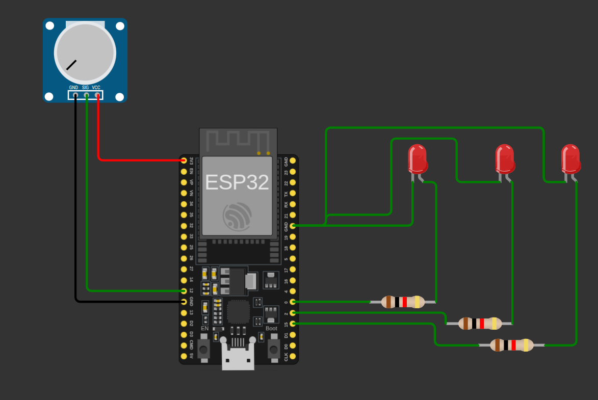
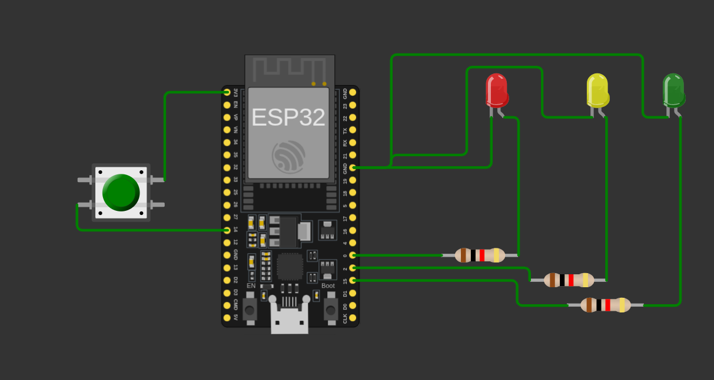
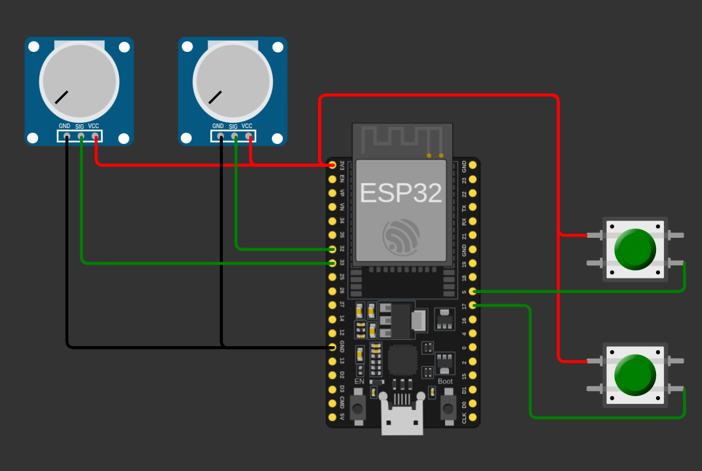

# Exercice 08 — Lecture ADC et formatif




## Question 1

Faites en sorte que la fréquence de clignotement de la DEL soit contrôlée par un potentiomètre. Autrement dit, la valeur lue sur la broche centrale du potentiomètre doit influencer la vitesse de clignotement de la DEL.

## Question 2

Créez un système qui permet de déterminer à quel moment la DEL doit s’allumer en fonction de la valeur du potentiomètre.

Autrement dit, lorsque la valeur lue par le potentiomètre dépasse un certain seuil, la DEL doit s’allumer. Si la valeur descend sous ce seuil, la DEL doit s’éteindre.

## Question 3

Réalisez un montage permettant de lire la sortie d’un potentiomètre. Connectez ensuite trois DEL à l’ESP32.

Concevez un programme qui allume une DEL en fonction de la valeur lue par le potentiomètre. La sortie du potentiomètre varie de 0 à 4095. Cette plage doit être divisée en trois parties :

- Entre 0 et 4095/3 : la DEL 1 est allumée.
- Entre 4095/3 et 2 × 4095/3 : la DEL 2 est allumée.
- Entre 2 × 4095/3 et 4095 : la DEL 3 est allumée.

## Question 4



Simulez un feu de circulation à l’aide de trois DEL (verte, jaune et rouge) et d’un bouton poussoir permettant à un piéton de déclencher le passage au feu rouge.

Les consignes sont les suivantes :

- Chaque lumière doit rester allumée pendant exactement 4 secondes.
- Lorsqu’on appuie sur le bouton, le feu passe au jaune pendant 2 secondes, puis au rouge pendant 6 secondes, avant de reprendre son fonctionnement normal.

## Question 5

Imaginez une porte munie d’une sonnette spéciale qui permet de l’ouvrir lorsqu’on appuie sur un bouton selon un code secret défini par la durée des pressions.

Reproduisez le fonctionnement de cette porte à l’aide d’un circuit simple utilisant un bouton poussoir.

Le format du code secret est défini par un tableau :

```py
[1, 3, 2]
```

Ici, le code `[1, 3, 2]` signifie que l’utilisateur doit appuyer sur le bouton pendant au moins 1 seconde, le relâcher, puis appuyer pendant 3 secondes et le relâcher à nouveau. Enfin, il doit appuyer pendant 2 secondes pour compléter le code et ouvrir la porte.

Lorsque l’utilisateur entre le bon code, affichez le message « Porte ouverte » dans le terminal.

## Question 6

Pour Noël, vous décidez de fabriquer une guirlande de DEL artisanale. Réalisez un arrangement de quatre DEL de couleurs différentes qui clignotent de manière aléatoire. La fréquence de clignotement doit également être aléatoire.

## Question 7




On décide de fabriquer une calculatrice particulière permettant d’effectuer des opérations entre deux nombres.

Deux potentiomètres servent à choisir les deux nombres : le premier nombre est contrôlé par le premier potentiomètre et le deuxième par le second. Les deux valeurs sont comprises entre 0 et 4095.

Un premier bouton poussoir permet de choisir le type de calcul : addition, soustraction, division ou multiplication.

Un second bouton poussoir permet de lancer le calcul.

Le résultat doit ensuite être affiché dans le terminal.

(Vous pouvez ignorer les cas particuliers, comme la division par zéro.)

