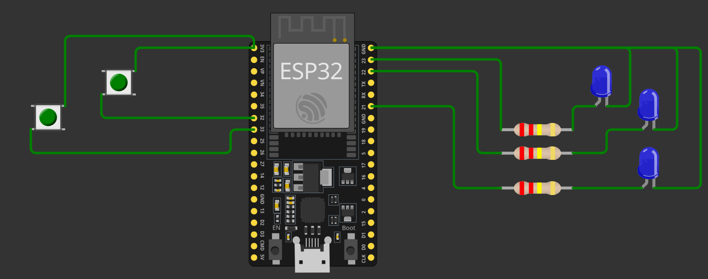
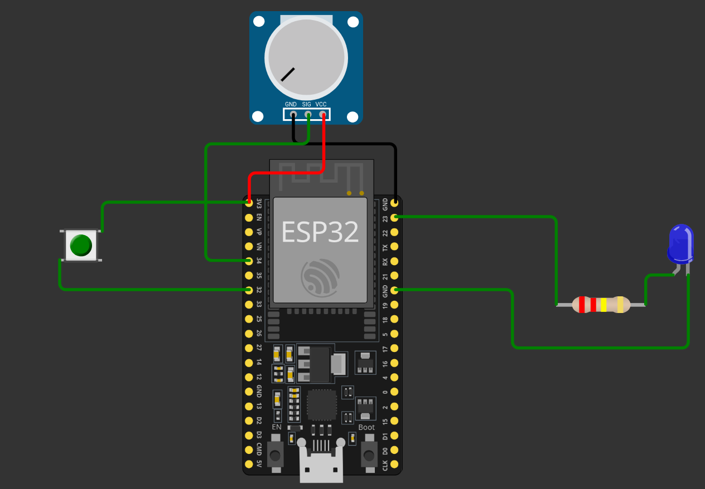

# Examen 2 (25%)

## Consignes

- L’usage des LLM (IA) est interdit.
- L’usage d’appareils ou d’applications permettant la communication est interdit.
- Le plagiat, de manière générale, est interdit.
- Vous avez droit à toute la documentation que vous désirez, numérique ou physique.
- Si vous souhaitez faire des recherches en ligne, utilisez **https://udm14.com/**.
- L’examen nécessite l’utilisation de la plateforme **exam.net**. Vous trouverez le lien dans le devoir associé à l’examen sur Teams.
- Votre remise doit respecter le format établi dans les documents qui vous sont fournis.
- Tentez de reproduire le circuit le plus fidèlement possible.
- À la fin de l’examen, remettez votre travail sur Teams.

---

## Question 1 — Incrémenter et décrémenter (25 %)

Ce circuit utilise trois DEL pour représenter un compteur binaire allant de 0 à 7 : la première DEL a une valeur de 1, la deuxième une valeur de 2 et la troisième une valeur de 4. Écrivez un programme qui affiche la valeur d’une variable servant de compteur et qui permet de modifier cette variable grâce à deux boutons-poussoirs. Le premier bouton ajoute 1 à la valeur du compteur, et le deuxième bouton retire 1 à la valeur du compteur.

Autrement dit :

- Les DEL affichent la valeur du compteur en format binaire (sur 3 bits).
- Un bouton augmente la valeur du compteur.
- Un bouton réduit la valeur du compteur.

---

## Question 2 — Un curseur (25 %)

Cette question utilise le même montage que la question 1. En utilisant le même circuit et les mêmes branchements qu’à la question précédente, écrivez un programme qui permet de déplacer une DEL allumée à l’aide de deux boutons-poussoirs : un bouton déplace la DEL allumée vers la droite, et l’autre la déplace vers la gauche.

Au départ, une seule DEL est allumée. Un appui sur le bouton droit fait en sorte que seule la DEL immédiatement à droite de la DEL actuelle soit allumée. Un appui sur le bouton gauche fait en sorte que seule la DEL immédiatement à gauche de la DEL actuelle soit allumée.

Autrement dit :

- Une seule DEL est allumée au départ (n'importe laquelle).
- Lorsqu’on appuie sur un bouton, la DEL actuellement allumée s’éteint et la DEL située à sa droite ou à sa gauche s’allume.
- Le bouton de droite sélectionne la DEL située à droite de la DEL actuelle.
- Le bouton de gauche sélectionne la DEL située à gauche de la DEL actuelle.

---

## Question 3 — Clignotement

  

À partir de ce montage, écrivez un programme qui fait clignoter une DEL. La fréquence de clignotement de la DEL peut être manipulée par le potentiomètre afin de rendre le clignotement plus rapide ou plus lent. Toutefois, une nouvelle fréquence ne doit être appliquée qu’après un appui sur le bouton-poussoir.

Autrement dit :
- Le potentiomètre contrôle la fréquence de clignotement de la DEL. Il est en mesure de rendre le clignotement de la DEL plus rapide ou plus lent.
- Un changement de fréquence de clignotement ne prend effet qu’après un appui sur le bouton-poussoir.

**Il n’est pas nécessaire que la nouvelle fréquence soit appliquée instantanément après l’appui. On peut maintenir le bouton enfoncé pendant toute la durée des `sleep` présents dans la boucle, et la fréquence sera appliquée dès que le programme revient lire le bouton. Cette façon de faire est parfaitement valide.**

---

## Question 4 — Deviner le nombre (25 %)

À l’aide du circuit présenté plus haut (question 3), écrivez un programme qui permet de deviner un nombre à l’aide d’un potentiomètre et d’un bouton-poussoir.

À l’initialisation du programme, un nombre est choisi au hasard. À l’aide du potentiomètre, choisissez ensuite un nombre entre 0 et 4095. Vous pouvez confirmer votre choix en appuyant sur le bouton poussoir. Si la valeur choisie avec le potentiomètre est supérieure au nombre aléatoire, le programme affiche « Nombre trop grand ». Si elle est inférieure, le programme affiche « Nombre trop petit ». Si c'est la bonne valeur, votre programme doit afficher un message de victoire.

Le programme doit tolérer une certaine incertitude (marge d'erreur) dans les valeurs du potentiomètre afin de fonctionner correctement (je vous conseille 100). Par exemple, si le nombre aléatoire est 2000 et que vous choisissez à l'aide du potentiomètre 1910, le programme doit tout de même afficher un message de victoire.

Autrement dit :

- Un nombre aléatoire est choisi.
- Le potentiomètre permet de choisir une valeur.
- Le bouton permet de confirmer la valeur.
- Après chaque appui sur le bouton, un message indique si le nombre choisi est trop petit ou trop grand.
- Si la valeur choisie est suffisamment proche du nombre aléatoire (à l'aide d'une marge d'erreur), la partie est gagnée.

